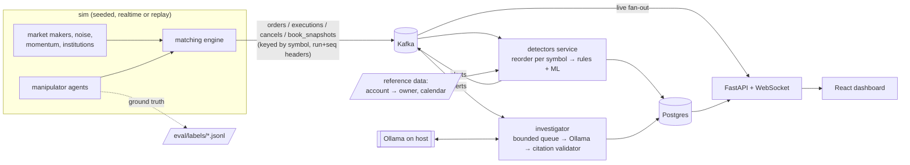

# Tripwire

Real-time market-abuse surveillance on a simulated exchange. A seeded agent-based market
streams orders, trades and cancels through Kafka. Rule detectors and an Isolation Forest
flag spoofing, layering, wash trading and marking the close. A local LLM (Ollama) writes
a compliance case report for each alert, and every order it cites is checked against the
stored events. A React dashboard shows the order book, trades, alerts and case files
live. Everything runs locally with `docker compose` plus Ollama on the host: no cloud,
no paid APIs.



Detectors and the ML scorer are pure functions over an event stream. The Kafka service is
a thin runner around them, and the eval harness feeds the same events in-process. That
gives one codebase with two paths: a streaming demo and a fast, deterministic eval.

## Setup

Requirements: Docker, [uv](https://docs.astral.sh/uv/), Ollama, Node 22 (only for
frontend development).

```bash
ollama pull qwen2.5:7b-instruct      # any Ollama model works: set OLLAMA_MODEL
uv sync
make demo                            # compose up + simulator, opens http://localhost:8000
make doctor                          # pass/fail health table for the running system
```

| target | what it does |
|---|---|
| `make up` / `make sim` / `make down` | start the stack / start the realtime simulator / stop |
| `make eval` | rules, ML, union and fusion on 10 seeded days, plus LLM citation accuracy |
| `make bench` | engine, detector and end-to-end Kafka throughput, alert latency |
| `make check` | ruff, mypy, fast tests, determinism and leakage checks, 1-day smoke eval vs baseline |
| `make check-full` | slow tests, 20-day eval diffed against the last run, frontend build, bench |
| `make train` | refit the Isolation Forest on simulated clean days |

`SIM_SPEED` (default 5) sets how many simulated seconds pass per wall second. A
two-hour session takes 24 minutes. `docker compose --profile debug up` adds kafka-ui
on :8080.

## How it works

**Exchange and simulator.** A price-time priority matching engine (limit and market
orders, partial fills, cancels, self-trade prevention per account) sits inside a
discrete-event simulator with a nanosecond simulated clock and a seed, so a run is
reproducible. `make check` replays a day in two fresh interpreters and compares
event-stream hashes. The legitimate population contains look-alikes on purpose:

- market makers that cancel and replace almost every quote and requote within
  milliseconds of a fill, and quote more size on one side when carrying inventory;
- institutions that rest large orders for minutes and sometimes work a rebalance
  through the last minutes of the session;
- noise traders that lean towards the heavier side of the visible book (which is what
  makes spoofing pay).

Manipulator accounts trade normally outside their episodes. Account and owner ids are
shuffled, so ids never reveal roles. Ground-truth labels (type, owner, accounts, window,
order ids) are written only to `tripwire/eval/labels/`. `tests/test_leakage.py` checks
statically and at runtime that `detectors/` and `ml/` never import, reference or read
them.

**Detection rules** (`tripwire/detectors/`, thresholds in `config.toml`, sliding windows
in event time):

| rule | fires when |
|---|---|
| spoofing | an account cancels a large order (≥ 2,000 shares, ≥ 3× the touch size, ≥ 5× the fill) placed at or near the touch, within 100 ms of trading on the other side, and the order is ≥ 6× all of the account's opposite-side interest |
| layering | after a fill, the account cancels orders at ≥ 3 price levels on the other side within 100 ms, totalling ≥ 2,500 shares and ≥ 5× the fill |
| wash | ≥ 3 trades within 10 minutes between different accounts with the same beneficial owner (exchange KYC data), where the passive leg rested ≤ 2 s |
| marking the close | in the last 5 minutes, one account's aggressive volume is ≥ 3,000 shares, ≥ 25% of the symbol's volume, ≥ 85% one-sided, and the price moved ≥ 4 ticks its way |

The opposite-side-interest condition is what separates spoofing from a market maker that
is skewing size against inventory. Both pull an order within milliseconds of a fill, but
the market maker is quoting both sides. Each rule has a positive and a negative scenario
test, with the market maker as the main negative.

**ML layer.** Per account and symbol, 5-minute windows of order-to-trade ratio, cancel
ratio, median order lifetime, size outliers, price impact, end-of-session aggressive share
and same-owner trade ratio. An Isolation Forest is trained on simulated clean days, and
its alert threshold is the 99.5th percentile on held-out clean days. *Union* takes every
rule and ML alert. *Fusion* flags windows where a noisy-OR of the rule and ML scores
reaches 0.6.

**Investigator.** It consumes alerts through a bounded queue with configurable
concurrency; when the queue is full the consumer pauses, so backlog stays in Kafka as lag
and detection is never slowed. It asks Ollama for a JSON-schema-constrained report
(temperature 0) grounded in an evidence table of the alerted accounts' events. The
validator requires every cited order to exist in the window, with matching event, time,
side, size and price. On failure it retries once with the errors fed back. If it still
fails, the report is stored as `unverified`; if Ollama is down, a template report is
stored. Regulation references (SEC Exchange Act §9(a), Rule 10b-5, CEA §4c(a)(5)(C), EU
MAR Art. 12, SEBI PFUTP Regulations 2003) come from a static mapping, never from the
model, and are labelled general reference, not legal advice.

**Runtime health.** Compose healthchecks gate startup. Every service upserts a heartbeat
(last event time, processed count) every 5 s. `/ready` checks Kafka topics, Postgres and
that the Ollama model is pulled. `make doctor` and the dashboard status bar show
heartbeats, consumer lag, the LLM queue depth and the share of unverified reports.

## Results

All numbers come from committed result files: `tripwire/eval/results/full_run.json`
(20 simulated days, seeds 1000-1019, 6.56M events) and `bench.json`.

| method | spoofing F1 | layering F1 | wash F1 | marking close F1 | overall precision | overall recall | overall F1 |
|---|---|---|---|---|---|---|---|
| rules | 0.868 | 0.933 | 1.000 | 0.919 | 1.000 | 0.863 | 0.926 |
| ML (Isolation Forest) | - (0/60 found) | - (0/40 found) | 0.857 | 1.000 | 0.308 | 0.312 | 0.310 |
| union | 0.868 | 0.933 | 1.000 | 1.000 | 0.631 | 0.881 | 0.736 |
| fusion | 0.835 | 0.919 | 1.000 | 1.000 | 0.694 | 0.856 | 0.767 |

What this shows:
- **Rules** found 138 of 160 episodes with no false positives on these days. The misses
  are, by design, the subtler manipulators: spoof orders below the size floor or pulled
  after more than 100 ms (recall 0.767), and closing pushes too weak to move the price
  4 ticks.
- **The unsupervised model** only sees behaviour that is extreme compared with clean days:
  same-owner trading and end-of-day aggression. A spoof or layer is a few orders inside a
  5-minute window full of normal activity, and the forest does not separate it.
- **ML's best contribution** is the three marking-the-close episodes the rules missed:
  union recall 0.881 vs 0.863, at the cost of precision.
- **Fusion** keeps most of that recall with fewer false positives than union.

**LLM case reports** (`qwen2.5:7b-instruct`, 10 sampled alerts): 67 of 68 cited orders
matched the stored events. 9 reports were verified on the first try and 1 stayed
unverified after the retry; median 38 s per report on this laptop. A run during phase 6
gave 71/72, so expect small run-to-run differences even at temperature 0.

**Throughput and latency** (`bench.json`, one simulated day of 328,609 events, process
pinned to one performance core of an i5-13500HX):

| stage | events/s |
|---|---|
| matching engine (278,760 replayed commands) | 789,466 |
| rule detectors, in-process | 601,106 |
| ML window scorer, in-process | 915,773 |
| rules + ML, in-process | 342,632 |
| end to end through Kafka, max rate | 96,835 |

At a paced 5,000 events/s (about 20× the demo rate), alert latency from the triggering
event's Kafka create time to the alert being ready was p50 83 ms and p99 100 ms over 16
alerts. This excludes the Postgres write the service does before publishing. Profiling
and the optimisations (vectorised forest scoring, event-type dispatch, consumer batching)
are written up with before/after numbers and flamegraphs in
[`performance.md`](tripwire/eval/results/performance.md).

## Design decisions

- **Pure logic, thin runners.** The detector service, the eval and the benchmark all use
  the same `DetectionPipeline`. The eval needs no Kafka and simulates and scores a 2-hour
  day in a few seconds.
- **Exact ordering across topics.** Kafka orders only within a partition, but a detector
  needs an order's acceptance before its fill. The simulator stamps a per-symbol sequence
  number on every message, and the consumer restores the exact per-symbol order.
  Time-driven logic (layering deadlines, ML windows, the close) uses per-symbol event
  time, and a test checks that processing a day symbol by symbol yields the same alerts.
- **Event time everywhere.** No detector reads the wall clock, so replay, realtime and
  backlog catch-up give the same results.
- **The LLM never decides facts.** It writes prose over an evidence table. Citations are
  validated mechanically, and regulations come from a static file.
- **Labels never leave the eval.** The simulator writes them to files, the eval reads
  them back, and a test stops the detector and ML packages from touching them.
- **Hand-written SQL, msgspec on the hot path.** Pydantic is used only at the API
  boundary.

## Limitations

- **Simulated data.** The market, the manipulators and their look-alikes were all written
  by the same person who wrote the detectors. Thresholds were tuned on separate simulated
  seeds (0-9), but perfect precision here says more about the simulator than about real
  markets. Real abuse is rarer, more varied and adaptive.
- **Small model.** A 7B local model writes adequate but generic narratives. Citation
  validation catches wrong facts, not weak reasoning.
- **Compressed sessions.** A session is two hours with three symbols and about 35
  accounts, far smaller than a real venue.
- **Single-node setup.** One Kafka broker, one Postgres, one detector process. Detector
  state is in memory, so a restart rebuilds it from the point where it rejoins.
- **Noisy throughput figures.** Numbers come from one laptop and vary ±10% between runs.
  The smoke eval's throughput gate compares against a baseline recorded early on; see
  `make propose-baseline` and `make approve-baseline`.

## Repository layout

```
tripwire/
  common/        event schemas (msgspec), codec, config, Kafka helpers, Postgres, reference data
  exchange/      order book + matching engine (pure, no I/O)
  sim/           discrete-event simulator, agents, manipulators, Kafka streaming service
  detectors/     rule detectors, shared market state, pipeline, Kafka runner
  ml/            window features, Isolation Forest training and scoring, fusion
  investigator/  evidence window, Ollama agent, citation validator, regulations, service
  api/           FastAPI REST + WebSocket
  eval/          eval harness, benchmarks, labels/ (git-ignored), results/
  ops/           heartbeats, doctor, CPU pinning
frontend/        React + Vite + Tailwind dashboard
sql/schema.sql   hand-written schema
tests/           engine, simulator, detectors, ML, investigator, API, ops, leakage
```
